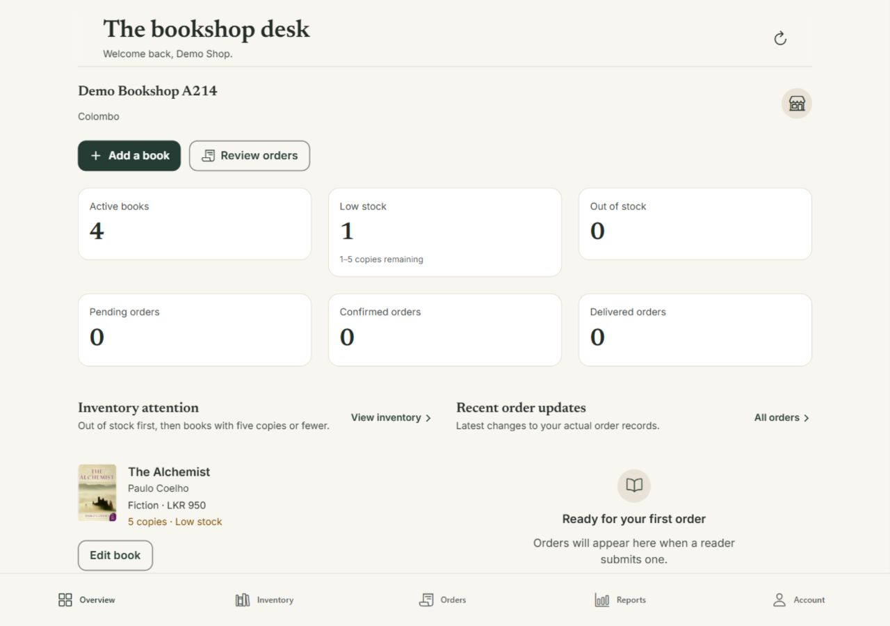
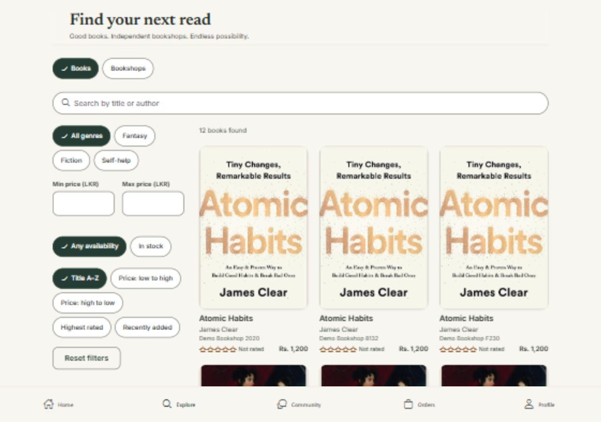
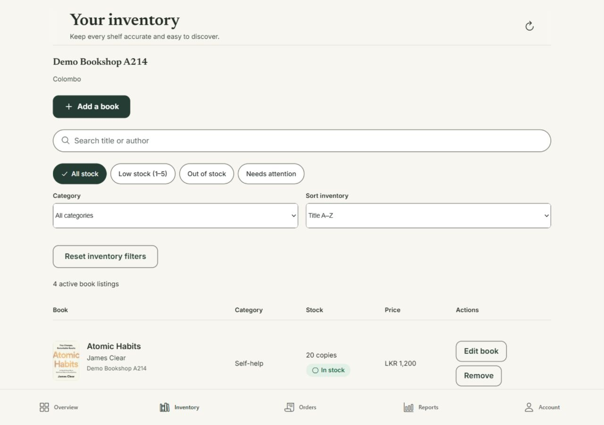

# Poth Collective

**An editorial book marketplace and community for readers and independent bookshops.**

Poth Collective brings book discovery, reading conversations and shop operations into one React Native / Expo application, with a responsive web showcase and an authenticated Express/MongoDB API.

This standalone portfolio edition derives from [Poth Book Community Service](https://github.com/vranasinghe/Poth-bookCommunity-service). It includes the later reader and merchant redesigns, ownership controls, session restoration and automated validation. Original collaborators are credited in [CREDITS.md](CREDITS.md).

## A look inside




## Reader experience

- Discover books by title, author, category, price and availability.
- Explore bookshops, follow favourites, read reviews and join the community.
- Submit orders with delivery details and payment-slip evidence.
- Track order status and manage profiles, posts and reviews.

## Merchant experience

- See actual stock attention and order counts across owned shops.
- Search, filter and manage cover-led inventory with authoritative quantities.
- Review private order details and follow permitted fulfilment transitions.
- View real inventory distributions and publish historical stock updates.




## Architecture

Expo Router, React Native, TypeScript and a shared design system power the frontend. Express, Mongoose/MongoDB, JWT, Cloudinary and an explicit order lifecycle power the API. Web hosting is configured for Vercel; the API has a Render Blueprint.

See [architecture](docs/ARCHITECTURE.md), [deployment](docs/DEPLOYMENT.md), [API behavior](docs/API_CHANGES.md) and [data lifecycle](docs/DATA_LIFECYCLE.md).

## Run locally

Use Node.js 22. Copy `backend/.env.example` to `backend/.env` and `frontend/.env.example` to `frontend/.env`, then provide your own credentials. The frontend environment contains only the public API origin.

```sh
cd backend
npm ci
npm start
```

In another terminal:

```sh
cd frontend
npm ci
npm run web
```

The API listens on port 5000; Expo web uses port 8080. Native devices need a reachable API origin instead of the computer's localhost.

## Validation

The Phase 4 implementation passed 221 backend and 268 frontend tests, TypeScript checks and Android/iOS/web exports. CI reruns backend checks, frontend tests, type checking and a web export for this standalone edition. Native device visual testing is still pending.

```sh
cd backend
npm run check
npm test
cd ../frontend
npm test -- --runInBand --testTimeout=20000
npx tsc --noEmit
npm run lint
```

## Showcase boundaries

Demo entry creates temporary accounts with sample content and automatic cleanup. Screenshots show a local demo account, not business performance. A payment-slip upload does not establish verified payment. Reports do not infer revenue from order totals. No real payment processing is integrated.

Actual live addresses and verification are recorded in [deployment status](docs/DEPLOYMENT_STATUS.md) only after the hosting providers confirm deployment.
