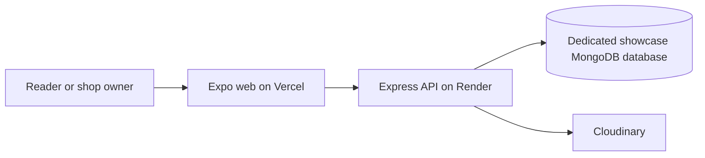

# Architecture

`frontend/app` defines reader/merchant routes; `src/ui` and `src/design` provide shared controls and semantic tokens. Account-scoped resources restore valid sessions and prevent previous-account responses from appearing after switching accounts.

`backend/app.js` creates Express without connecting a database. `server.js` loads private configuration, connects MongoDB, starts demo cleanup and serves `/health`. Controllers authorize roles and ownership before exposing private records. Orders reserve stock; legal transitions use compare-and-swap and cancellation restores stock once. Existing transaction/compensation behavior is retained.

Only `EXPO_PUBLIC_API_URL` belongs in the frontend build. MongoDB, JWT and Cloudinary credentials belong in Render's private environment. CORS uses explicit origins. The showcase has its own database and does not fall back to the original hosted API.

There is no card gateway or independent bank reconciliation. A slip is evidence for the owner to inspect. Counts and distributions use authorized records; stock quantities and submitted order totals do not establish settled revenue.
